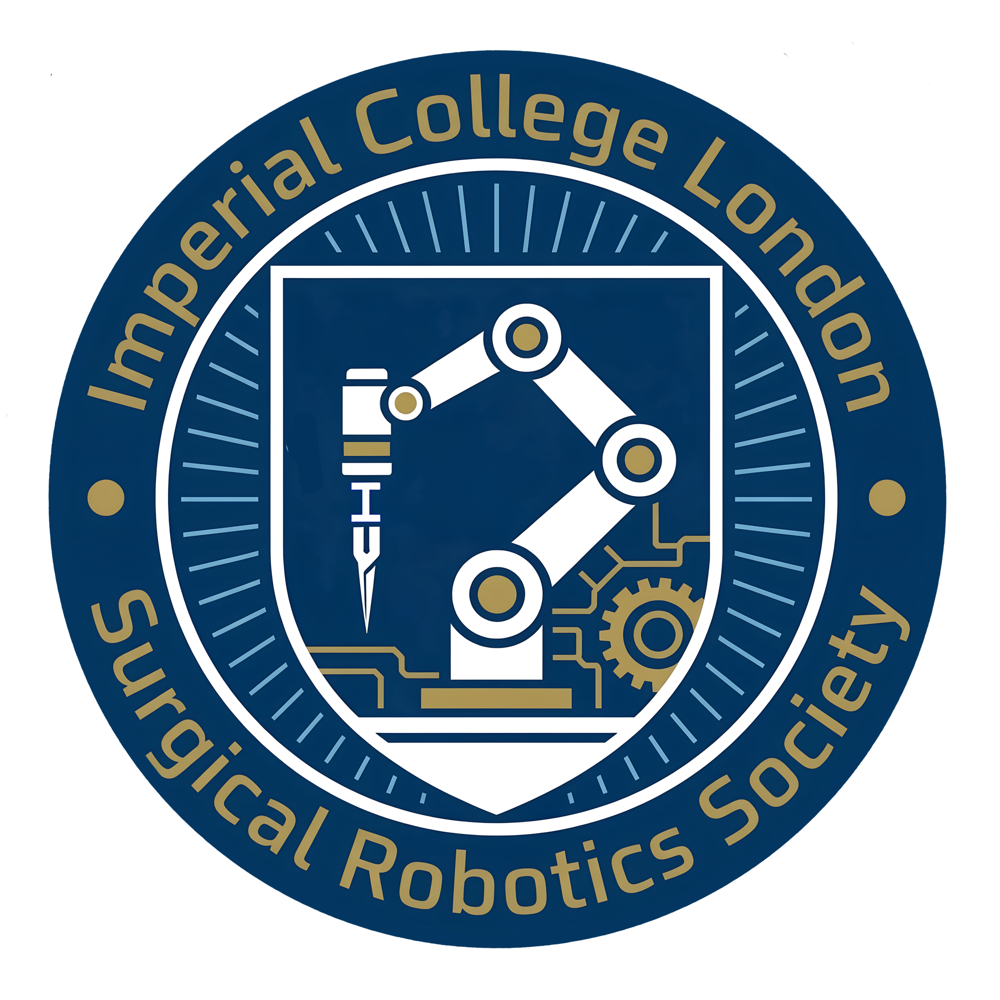

# Official ICSRS Project Repository

The Imperial College London Surgical Robotics Society (ICSRS) is developing a force-aware continuum endoscope. The project brings together mechanical design, electronics, controls and software to build a tendon-driven endoscope with low-cost force sensing.

## Current milestone

Build and test a single-degree-of-freedom prototype on the bench. The prototype will demonstrate controlled bending and measure contact force.

## Working in this repository

- Open an issue to track a task, record a decision or flag something another team needs. [View issues](https://github.com/unading726/official-icsrs-project-repo/issues)
- Open a pull request when a design file, document or piece of code is ready for teammates to review. [View pull requests](https://github.com/unading726/official-icsrs-project-repo/pulls)
- Use `main` to find the shared project files. Link the relevant issue when you update a file so the next person can see why it changed.

If you’re new to the team's workflow, follow a real change from issue to merge in [the GitHub walkthrough](docs/github-walkthrough.md).
