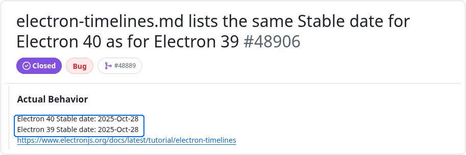
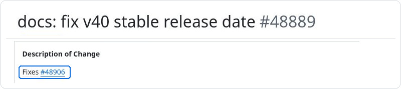
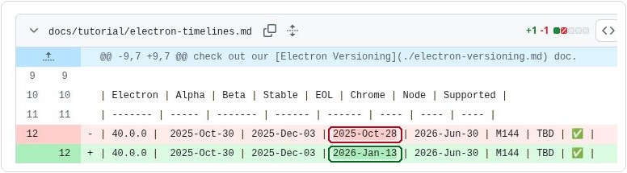
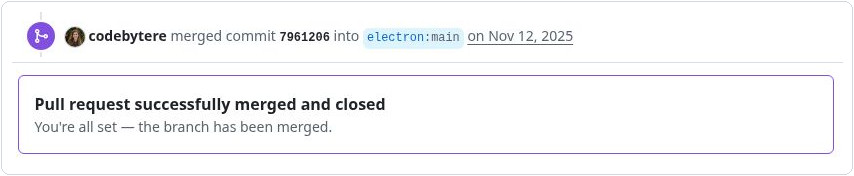

# Getting started with GitHub

A walkthrough for members of the Imperial College London Surgical Robotics Society.

Imagine opening a release calendar and seeing two versions with the same release date. That happened in Electron’s documentation. Follow the report and the one-line fix to see how a team records a problem, reviews an update and shares the result.

## 1. What did someone notice?

Electron 39 and 40 both showed **28 October 2025** as their stable release date. A reader opened an **Issue**, a page where the team can find the problem and discuss it. GitHub assigned it the number **#48906**, so a teammate can find the same conversation from a link or a reference to that number.

[Open the original Issue](https://github.com/electron/electron/issues/48906)

## 2. What does the contributor want to change?

A **pull request**, or **PR**, is a request for teammates to review a proposed update and bring it into the shared version when it’s ready. This PR links back to **#48906**, so a reviewer can see why the date needs changing.

[Open the original pull request](https://github.com/electron/electron/pull/48889)

## 3. Which line changed?

Open **Files changed**. The red line marked `−` shows the old entry for Electron 40. The green line marked `+` shows the replacement. Look for the date that changes from **28 October 2025** to **13 January 2026**.

[See the change on GitHub](https://github.com/electron/electron/pull/48889/changes)

## 4. Did the team accept it?

A reviewer asked the contributor to fill in the planned date. After the update was approved, the PR was **merged into `main`**. That means the correction became part of the shared version of the documentation.

[Read the review](https://github.com/electron/electron/pull/48889#pullrequestreview-3447777210) · [See the merged change](https://github.com/electron/electron/commit/7961206fcb78691195d42ab08d43652b6cf951dd)

## How we’ll use this at ICSRS

If a connector choice will affect another team’s work, you can ask in WhatsApp and post the confirmed choice and its link on the relevant Issue. When you have an updated file you’d like everyone to use, open a PR and say what changed, what you checked and what you’d like a teammate to look at.

Two words for when you make your first change

- A **branch** gives you a place to work on a proposed update while others use `main`. Start from your Issue and use the branch name GitHub suggests.
- A **commit** saves a set of changes with a short description. It gives you and your reviewers a point in the file history to return to.

